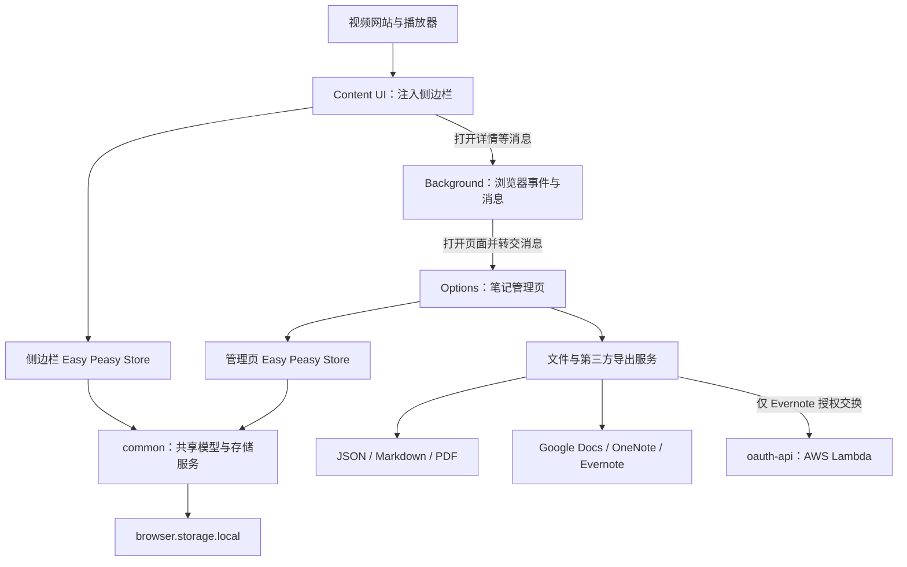
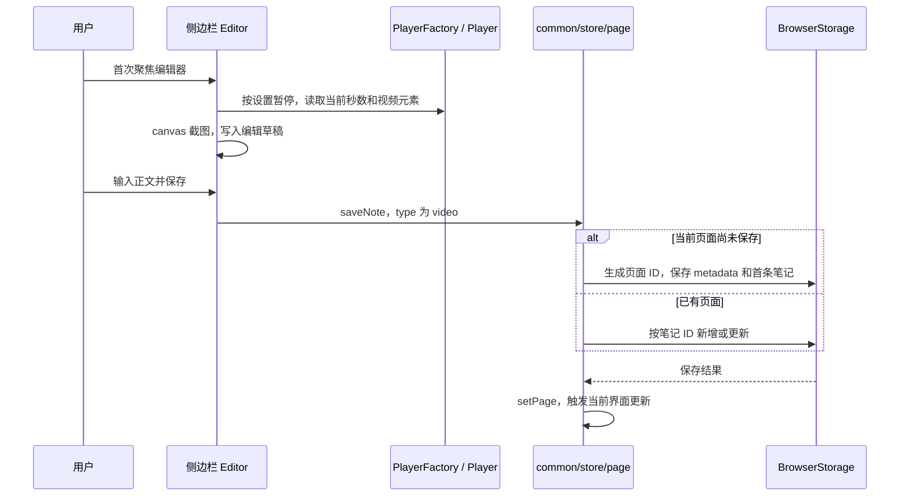

# YiNote 项目架构与二次开发指南

> 本文基于当前仓库源码梳理；路径均相对仓库根目录。构建与测试结果见第 7 节，线上 OAuth 服务未验证。
> **版本边界：当前扩展代码为 1.7.0；Chromium 使用 Manifest V3，Firefox 保留 Manifest V2。README 顶部的 YiNote 2.0 是线上产品公告，不代表当前代码已升级到 2.0。**

## 1. 先建立整体认知

YiNote 是以浏览器本地存储为中心的视频笔记扩展，不是一个依赖业务服务器才能工作的 Web 应用。

- **Content UI**：注入视频网站，显示侧边栏，识别播放器，记录时间戳与截图。
- **Options**：独立扩展页面，管理收藏、笔记、标签、设置，执行导入和导出。
- **Background**：响应工具栏点击、打开管理页、处理部分下载/复制操作，以及旧数据迁移。
- **Common**：两套界面共用的数据模型、存储服务、组件和导出能力。
- **OAuth API**：只承担 Evernote 授权交换，不是笔记数据库或云同步服务。

最重要的边界：**侧边栏与 Options 各自创建 store，但复用模型并直接访问同一份浏览器存储；笔记 CRUD 不经过 Background。**



技术栈以 JavaScript/JSX 为主：React 16、React Router 5、Easy Peasy 3、Material UI 4、styled-components 5、i18next、Webpack 4、Babel。仓库采用 Yarn Workspaces；锁文件为 Yarn v1 格式。版本升级应按旧项目处理，而不是直接套用新版 React/MUI/Router 的 API。

## 2. 目录与包的职责

```text
packages/
├── extension/                 浏览器扩展主体
│   ├── manifest.common.json   权限、注入规则、后台与资源声明
│   ├── webpack*.js            三入口构建和浏览器差异
│   ├── _locales/              扩展文案
│   └── src/
│       ├── ui/                注入网页的侧边栏
│       │   ├── containers/    页面与业务组件
│       │   ├── components/    UI 局部组件
│       │   ├── store/         侧边栏状态
│       │   ├── services/      播放器、课程平台笔记读取、DOM 工具
│       │   ├── hooks/         平台笔记读取与批量截图
│       │   └── utils/         截图等工具
│       ├── options/           独立管理页：containers、store、services
│       ├── background/        后台消息与历史迁移
│       ├── vendors/           随扩展加载的 polyfill 和播放器脚本
│       ├── i18n.js            扩展 React 界面的国际化初始化
│       └── index.js           导出 ui，供 playground 使用
├── common/                    共享组件、store、服务、工具、主题与资源
├── browser-extension-oauth2/   基于 browser.identity 的 OAuth2 封装
├── oauth-api/                 Evernote OAuth 的 Serverless 接口
├── playground/                在普通网页中调试扩展 UI 和视频场景
└── landing/                   Gatsby 宣传网站，与扩展业务相对独立
```

包依赖主链为：

```text
playground → extension → common → browser-extension-oauth2
landing：独立 Gatsby 项目
common 的 Evernote 集成 → HTTP → oauth-api → Evernote
```

只修改笔记功能时，优先关注 `extension` 与 `common`；不必先启动官网或部署 OAuth API。建议从仓库根目录安装依赖，部分包依赖 workspace 提升后的依赖可见性，并非完全独立可安装。

## 3. 三个运行入口

真正的 Webpack 入口在 [webpack.common.js](packages/extension/webpack.common.js)，不是 `src/index.js`。

| 入口 | 源文件 | 工作内容 |
| --- | --- | --- |
| `content` | [ui/content-script.js](packages/extension/src/ui/content-script.js) | 创建 `YiNote` 并渲染侧边栏 |
| `background` | [background/index.js](packages/extension/src/background/index.js) | 注册浏览器事件与消息处理器 |
| `options` | [options/index.js](packages/extension/src/options/index.js) | 创建独立 React 应用和管理页 store |

### 3.1 Content UI：不影响宿主网站地址的侧边栏

启动链：`content-script.js → ui/index.js → containers/App/index.js`。

- Manifest 在匹配的 HTTP、HTTPS、file 页面上，于 `document_end` 注入脚本；没有配置 `all_frames`。
- `YiNote.render()` 向 `document.body` 添加普通 `div` 容器，再挂载 React；**没有使用 Shadow DOM**。
- 使用 `MemoryRouter`，因此侧边栏切换路由不修改宿主页面 URL。
- 初始面板关闭；工具栏点击经后台发送 `togglePanel`，打开后尝试识别播放器。
- 路由：`/video-notes` 为视频笔记，`/search` 为检索，`/reload` 为扩展上下文失效后的提示。
- App 每 300ms 检查宿主 URL；变化后重置播放器和页面/编辑状态，或按设置刷新网站。

关键文件：[ui/index.js](packages/extension/src/ui/index.js)、[ui/containers/App/index.js](packages/extension/src/ui/containers/App/index.js)。

### 3.2 Options：完整的笔记管理应用

使用 `HashRouter`，有独立的 Easy Peasy store。

| 路由 | 容器 | 职责 |
| --- | --- | --- |
| `/` | [Bookmarks](packages/extension/src/options/containers/Bookmarks/index.js) | 收藏列表、标签筛选；相关工具栏提供批量操作 |
| `/pages/:id` | [Page](packages/extension/src/options/containers/Page/index.js) | 单页笔记、截图、标签；笔记子组件支持编辑和截图标注 |
| `/settings` | [Settings](packages/extension/src/options/containers/Settings/index.js) | 视频设置、JSON 导出和导入等 |

路由和消息接收在 [options/containers/App/index.js](packages/extension/src/options/containers/App/index.js)。详情导出按钮在 [Page/Toolbar/index.js](packages/extension/src/options/containers/Page/Toolbar/index.js)，不要只在 `Page/index.js` 查找。

### 3.3 Background：消息协调，而非数据中心

| 事件或消息 | 作用 |
| --- | --- |
| 工具栏点击 | 向当前标签页发送 `togglePanel`；发送失败则打开 Options |
| `open-options` | 打开 Options，并重试转交 `message.data` 中的消息 |
| `export-file` | 使用 downloads API 下载，文件服务的 Firefox 分支会使用它 |
| `copy` | Chromium 通过 offscreen document 复制文本；Firefox 使用后台页面 DOM |
| 安装/更新事件 | 从 `0.6.4` 更新时执行专门的数据迁移，备份成功后才修改存储 |

侧边栏打开笔记详情的消息链：

```text
VideoNotesView/Toolbar
  → runtime.sendMessage({ action: 'open-options', data: { action: 'open-page', data: id } })
  → Background 打开 Options 并转交 data
  → Options App 接收 open-page
  → 路由 /pages/:id
```

`filter-by-tags` 同样由 Options 处理。Background 没有通用的 iframe 消息路由；不要把 `window.postMessage` 的页面播放器协议与 `browser.runtime` 的扩展消息混淆。

## 4. 状态层与持久化

### 4.1 Store 如何组织

| 层 | 模型 | 用途 |
| --- | --- | --- |
| 共享 | `page` | 当前页面、笔记 CRUD、收藏、标签 |
| 共享 | `settings`、`alerts`、`tagDialog` | 持久化设置、确认弹窗、标签弹窗状态；由各界面按需组合 |
| 侧边栏 | `app`、`videoNotes`、`search` | 面板/URL/广告状态、编辑草稿、搜索条件与结果 |
| 管理页 | `app`、`bookmarks` | 页面布局/反馈、收藏列表/标签筛选/工具栏状态 |

入口：[ui/store/store.js](packages/extension/src/ui/store/store.js)、[options/store/store.js](packages/extension/src/options/store/store.js)、[common/store/page.js](packages/common/store/page.js)。

项目沿用 Easy Peasy 的 `action`（改内存状态）、`thunk`（异步操作）、`actionOn/thunkOn`（响应其他 action）模式。扩展业务时优先沿用现有模型，不要再引入一套平行状态体系。

**复用的是模型定义，不是同一个内存 store。** 当前也没有基于 `storage.onChanged` 的统一跨页面状态同步机制，不能假定管理页修改后，已打开的侧边栏立即更新。

### 4.2 存储结构

[StorageFactory.js](packages/common/services/storage/StorageFactory.js) 在 `NODE_ENV === 'playground'` 时选择 `LocalStorage`，否则选择 `BrowserStorage`。正式扩展写入 **`browser.storage.local`，不是 `storage.sync`**。

以下是结构示意，不是仓库已有的 TypeScript 类型或严格 schema：

```text
<页面 UUID> → {
  id,
  meta: { url, title, description, image, ... },
  notes: [{ id, content, timestamp, type, image?, sections? }],
  tags?,
  createdAt?
}
settings   → { 设置项 }
evernote   → { accessToken, <页面 UUID>: 远端笔记 ID }
onenote    → { accessToken, <页面 UUID>: 远端页面 ID }
googledocs → { accessToken, 文件夹 ID 等缓存, <页面 UUID>: 远端文档 ID }
```

- 一条页面记录包含全部笔记；收藏不是另一张表，删除收藏实际删除整条页面及其笔记。
- `timestamp` 是视频秒数，`content` 是 Markdown 文本，截图内联保存在 `image` 的 data URI 中。可选 `sections` 保存分栏的 `id / kind / label / content`，并将可读 Markdown 同步到 `content`；二者不一致时以 `content` 为准。
- 页面 ID 使用固定 namespace 的 UUID v5：YouTube 根据视频 ID，其他 URL 去掉 hash 后生成，query 仍保留。见 [generatePageId.js](packages/common/utils/generatePageId.js)。
- 新笔记 ID 的生成逻辑基于正文和时间戳；更新时使用已有 ID。不要把 ID 当作随机流水号。
- `_getPages()` 全量读取存储，再按 key 是否为合法 UUID 筛出页面；新增其他 UUID key 数据可能被误当作页面。
- 搜索在内存中处理：收藏匹配标题，笔记匹配正文；输入直接作为正则表达式。标签组合筛选为 AND。
- 页面更新多采用“读取 → 修改 → 整页写回”，没有事务或并发冲突控制。

存储主实现：[BrowserStorage.js](packages/common/services/storage/BrowserStorage.js)。Playground 的 [LocalStorage.js](packages/common/services/storage/LocalStorage.js) 能力不完全对等，缺少部分设置、标签、导出等实现。

## 5. 核心业务链路

### 5.1 新建一条视频笔记



注意：**新笔记的时间戳和截图在开始编辑时采集，不是在点击保存时采集。** 修改这一交互，应看 [Editor/index.js](packages/extension/src/ui/containers/VideoNotesView/Editor/index.js)，而不是只改 storage。

其他入口：

- 点侧边栏笔记时间位置：`NoteItem → PlayerFactory.getPlayer() → seek(timestamp)`。
- 管理页中的时间链接：[buildAutoSeekUrl.js](packages/common/utils/buildAutoSeekUrl.js) 生成跳转地址，Content App 读取 `yinotetimestamp` 参数后定位播放。
- 截图：[takeScreenshot.js](packages/extension/src/ui/utils/takeScreenshot.js)，默认 360p，canvas 输出 JPEG；跨域视频或 iframe 不一定能截图，能够播放不代表能够截图。
- 截图标注：[options/containers/Page/VideoNoteItem/index.js](packages/extension/src/options/containers/Page/VideoNoteItem/index.js)，使用 markerjs，结果写回 `note.image`。

### 5.2 播放器适配与课程笔记读取是两套机制

**播放器适配**在 [ui/services/player](packages/extension/src/ui/services/player)：

- [Player.js](packages/extension/src/ui/services/player/Player.js) 定义约定：`getVideoElement`、`play`、`pause`、`seek`、`getCurrentTime`、`getDuration`。
- [PlayerFactory.js](packages/extension/src/ui/services/player/PlayerFactory.js) 优先按 YouTube URL 识别；否则依次尝试 `video`、YouTube iframe、Embedly iframe、`data-yinote="yinote-hook-player"`。
- `HTML5Player` 操作原生 video；`YoutubePlayer` 额外监听广告状态；iframe 实现依赖对应播放器 API。
- `HookPlayer` 通过 `window.postMessage` 与网页代码配合，网站必须实现相应动作。
- Factory 缓存当前播放器，宿主 URL 改变时由 App 重置；选择器顺序会影响同页多个播放器的匹配结果。

新增站点：优先复用 HTML5Player；需要特殊控制时新增适配类并注册到 Factory。不要把站点判断堆进 Editor。iframe 跨域限制、SPA 切视频和截图能力应分别验证。

**课程平台笔记读取**在 [ui/services/sync](packages/extension/src/ui/services/sync)：

```text
SyncFactory 按域名选择 Coursera / Udemy
  → SyncBase 和子类读取网站 DOM 中的笔记
  → useSyncNotes 向工具栏提供读取入口
  → useLoadScreenshots 逐条定位视频、截图、调用 saveNote
```

这里的 `sync` 是将平台已有笔记导入本地，不是云端双向同步。增加课程平台应扩展 `SyncBase` 并注册到 `SyncFactory`；DOM 选择器依赖第三方网站结构。

### 5.3 备份与第三方导出

- JSON 备份格式为 `{ version, data: pages[] }`；版本默认来自扩展 Manifest，不是独立 schema 版本。
- 常规备份包含页面、笔记、标签与截图，**不包含设置、OAuth token 和远端 ID 映射**。
- [importData.js](packages/extension/src/options/services/importData.js) 对已有页面直接拼接笔记，未去重；重复导入可能产生重复笔记。
- 文件/格式服务在 `common/services/file.js`、`markdown.js`、`pdf/`；Markdown 导出不包含截图，PDF 支持截图。
- [integration](packages/common/services/integration) 提供 Google Docs、OneNote、Evernote 导出，由 Options 直接调用。
- 第三方导出是单向创建，已有远端 ID 用来提示重复导出，并非远端覆盖更新或双向同步。

OAuth 边界：Google/Microsoft 使用 `browser-extension-oauth2` 的 `browser.identity.launchWebAuthFlow`，当前为 implicit flow（`response_type=token`），无 PKCE/refresh-token 流程；Evernote 先经 `oauth-api` 获取授权 URL 和交换令牌，再由扩展直接发送笔记。Token 缓存在扩展 local 存储中。

重新分发时需要核对 OAuth client ID、扩展身份产生的 redirect URL、Evernote 回调白名单及 API 地址。`REST_BASE_URL_DEV/PROD` 为构建期配置；Evernote consumer secret 必须保留在服务端，不能放进扩展包。

## 6. 常见需求：应该改哪里

| 需求 | 主要入口 | 联动检查 |
| --- | --- | --- |
| 侧边栏宽度、颜色、布局 | [common/withTheme.js](packages/common/withTheme.js)、`ui/containers/App/` | 组件内 styled、`ui/globalStyle.js`；主题默认 panel 宽度 380 |
| 改记笔记交互、保存时机 | `ui/containers/VideoNotesView/Editor/`、`ui/store/videoNotes.js` | `common/store/page.js`、暂停设置、截图时机 |
| 改侧边栏笔记展示 | `ui/containers/VideoNotesView/NoteItem/` | 共享 `MarkdownViewer`；管理页有独立 NoteItem |
| 改管理页笔记或截图标注 | `options/containers/Page/VideoNoteItem/` | markerjs、`saveNote`、PDF 和第三方导出 |
| 新增/调整管理页 | `options/containers/`、`options/containers/App/index.js` | Header、Drawer、路由、options store |
| 新增视频站点支持 | `ui/services/player/Player.js`、`PlayerFactory.js` | 播放器识别顺序、iframe/Hook 协议、SPA URL 变化 |
| 导入另一课程平台笔记 | `ui/services/sync/`、`hooks/useSyncNotes.js` | `hooks/useLoadScreenshots.js`、正文/时间解析 |
| 新增笔记或页面字段 | `common/store/page.js`、`common/services/storage/` | 编辑草稿、两套 UI、导入、导出、旧数据默认值和迁移 |
| 改页面去重或 URL 归一化 | `common/utils/generatePageId.js` | 自动跳转 query、已有数据 key 的兼容与迁移 |
| 搜索、标签筛选 | `ui/store/search.js`、`options/store/bookmarks.js` | `BrowserStorage.js`；正则输入与全量检索成本 |
| 新增设置 | `common/constants.js`、`common/store/settings.js` | `options/containers/Settings/`、消费者默认值、playground 适配 |
| 新增导出格式或服务 | `common/services/`、`common/services/integration/` | `options/containers/Page/Toolbar/`、授权和权限配置 |
| 修改权限、匹配站点或升级 Manifest | `manifest.common.json`、`webpack.common.js` | background、vendor 加载、OAuth、资源声明、浏览器差异 |
| 修改官网 | `packages/landing/src/` | Gatsby 页面与站点配置，不是扩展 UI |

样式不是 Shadow DOM 隔离：根 [babel.config.json](babel.config.json) 为 styled-components 添加 `.yi-note` 命名空间，`withTheme.js` 同时提供 Material UI 与 styled-components 主题。改容器类名/注入方式时要同步检查样式作用域。

**汉化入口**：[extension/_locales/en/messages.json](packages/extension/_locales/en/messages.json) 与 [src/i18n.js](packages/extension/src/i18n.js)。React 文案将 key 按 `_` 转成 namespace/嵌套对象，目前注册 `en` 和 `zh-CN`。新增语言不仅要增加 `_locales` 文件，还要接入 React 的 resources；浏览器原生 `browser.i18n` 与 React i18n 两条路径都要验证。官网使用独立的 `src/i18n.js` 和 `src/locales/{en,zh-CN}/` 资源，覆盖首页、导航、404、隐私页、SEO 和无障碍标签。静态 HTML 先以英文渲染，挂载后应用浏览器语言；导航栏支持手动切换并记住选择。新增文案需同时补齐两种语言。

## 7. 开发、构建与调试

以下命令在仓库根目录运行。收尾校验：173 项扩展测试通过，Chromium 与 Firefox 生产构建通过；官网国际化回归测试与 Sass 编译通过；官网完整构建因本机缺失 `sharp` 原生模块而未完成。

| 目标 | 命令 | 结果 |
| --- | --- | --- |
| 安装工作区依赖 | `yarn install` | 安装多包依赖；先核对旧工具链与 Node 兼容性 |
| Chromium 扩展开发 | `yarn start:ext` | Webpack watch，写入 `packages/extension/dist/chromium/`，不是 HTTP 服务 |
| Firefox 扩展开发 | `yarn workspace @yi-note/extension dev:firefox` | 写入 `packages/extension/dist/firefox/` |
| 只构建 Chromium | `yarn workspace @yi-note/extension build:chromium` | 生产产物和对应 ZIP |
| 同时构建两种扩展 | `yarn build:ext` | 顺序构建 Chromium、Firefox；ZIP 在根 `artifactory/` |
| 调试 UI/视频场景 | `yarn start:playground` | Webpack dev server，端口 4000 |
| 官网开发/构建 | `yarn start:landing` / `yarn build:landing` | Gatsby；构建输出 `packages/landing/public/` |

扩展主要产物为 `content.js`、`background.js`、`options.js`、`options.html`、`manifest.json` 和静态资源。浏览器应加载对应的 `dist/chromium/` 或 `dist/firefox/`，不是 `src/`。Chromium 构建还包含供复制操作使用的 offscreen 页面。

调试位置：

- 侧边栏、播放器、截图：目标视频网站的 DevTools。
- 笔记管理、设置、第三方导出：Options 页 DevTools。
- 扩展消息和迁移：扩展管理界面的 service worker 调试入口（Chromium），或后台页面调试入口（Firefox）。
- 修改 content script 后：等待构建结束，重新加载扩展，并刷新目标视频网站，避免旧脚本仍在运行。
- Playground 包含原生视频、YouTube iframe、Embedly 场景，但无法完整验证权限、后台、OAuth 或真实存储行为。

构建注意：

1. 两种浏览器分别输出到 `dist/chromium/` 和 `dist/firefox/`，两份 ZIP 也分别保存。加载时选择与浏览器匹配的目录。
2. Manifest 版本和 package 版本分别维护；前者用于扩展版本，后者用于 ZIP 名称，发版要一起修改。
3. 生产配置明确关闭压缩，注释说明是 Evernote SDK 的兼容问题，不宜直接开启。
4. `common` 和 OAuth2 包通过源码供扩展打包；不要求先单独构建所有 workspace。
5. OAuth API 的 `deploy:dev` / `deploy:prod` 是真实 AWS 部署，会产生外部资源/费用，不是本地调试命令。配置仍是 Serverless 1.x、`nodejs12.x`，且仓库未声明 Serverless CLI 依赖，需要单独现代化部署环境。

## 8. 二开前优先确认的限制

1. **维护 Chromium MV3 与 Firefox MV2 两条构建路径。** Chromium 后台运行在 service worker 中，不能依赖 `window` 和 `document`；复制操作通过 offscreen document 完成。修改 Manifest、消息或下载逻辑时须验证两种目标。
2. **依赖年代较旧。** Webpack 4、Gatsby 2、node-sass 4 与现代 Node/系统存在兼容风险；README 的 Node 最低版本不是当前环境可构建的保证。先建立可复现基线，再逐步升级。
3. **先备份再改存储。** 页面 ID、字段或导入合并策略的变更需要兼容旧数据。旧迁移只有 `0.6.4` 专项脚本，不是通用逐版本迁移框架。
4. **“导出并清空”不等于安全事务。** 清空调用会删除整个 local 存储，包括设置和授权；当前导出流程没有可靠等待文件成功落盘。不要用真实笔记试验清空/迁移。
5. **本地保存不等于云备份。** 删除扩展会失去其本地数据；第三方导出和课程平台 `sync` 都不是完整多设备同步。
6. **不可信 Markdown/导入数据要补安全边界。** 当前 Markdown 链路通过 `marked` 进入 `dangerouslySetInnerHTML`，未见显式 HTML 清洗。若做分享、联网导入，应先处理内容校验和清洗。
7. **扩展已有回归测试，根目录尚无统一测试入口和 CI。** 在 `packages/extension` 运行 `npm test`，或在根目录运行 `node --test packages/extension/tests/*.test.cjs`。测试覆盖运行时、MV3、迁移、编辑、时间戳、分栏与简介；不能替代真实浏览器和第三方服务验证。Playground 是人工调试工具，不是测试套件。

## 9. 推荐阅读与验证顺序

阅读顺序：

1. `extension/webpack.common.js` + `manifest.common.json`：确认运行上下文和权限。
2. `extension/src/ui/content-script.js` → `ui/index.js` → `ui/containers/App/index.js`：理解注入与路由。
3. `VideoNotesView/Editor/index.js` → `common/store/page.js` → `BrowserStorage.js`：走通保存链。
4. `PlayerFactory.js` + `HTML5Player.js`：理解视频适配。
5. `options/containers/App/index.js` → `Page/VideoNoteItem` → `Page/Toolbar`：理解管理、标注和导出。
6. 再按需求阅读 sync、PDF、第三方授权、后台迁移；不要从 vendor 或官网开始。

修改后的最小人工回归清单（当前未执行）：

- 原生视频：打开侧边栏，创建/修改/删除笔记，检查时间戳、截图和定位。
- YouTube/SPA：切换视频，确认页面身份、播放器和编辑草稿正确重置。
- 无视频页面：进入搜索，不应阻塞扩展使用。
- 管理页：同一页面数据、标签筛选、截图标注、设置持久化。
- 备份：使用测试数据导出 JSON、导入到隔离的测试扩展环境，并检查重复导入行为。
- 改过导出逻辑：分别验证 Markdown、PDF，以及需要授权的第三方服务。
- 改过消息或 Manifest：在目标浏览器验证工具栏开关、详情跳转、下载和权限。

建议第一步只选一个垂直功能，例如“修改笔记编辑交互”或“适配一个新视频站点”，走通 UI → store → service → storage 的现有链路，再考虑架构级升级。
